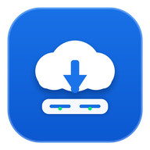

# NasDrop

<p align="center">
  
</p>

<p align="center">
  <strong>专为私有云 / NAS 打造的现代化 Android 文件管理器与随手存工具</strong><br>
  内置 Tailscale 用户态网络栈 · 局域网直连极速优先 · 媲美主流网盘的交互质感 · 随手分享即上传
</p>

<p align="center">
  <a href="https://github.com/anansite/NasDrop/releases/latest"></a>
  
  
  
  <a href="https://github.com/anansite/NasDrop/actions"></a>
</p>

---

## 💡 为什么做 NasDrop？

在手机上访问家庭 NAS，往往面临两难：
1. **外网连接门槛高**：要么花精力折腾公网 IP 与 DDNS 端口映射；要么安装官方 Tailscale / WireGuard，但它会**长期霸占手机系统唯一的 VPN 槽位**，与日常网络工具互斥冲突。
2. **移动端体验繁琐**：开源 WebDAV 客户端交互大多陈旧，看视频经常转圈或不支持 Range 拖动，存一张微信或相册图片到 NAS 要先导出、再打开 App、再层层寻找目录。

**NasDrop** 将 **Tailscale 用户态核心 (`tsnet`)** 与 **现代网盘级体验** 深度融合：
无需安装外部组网工具、不占用系统 VPN 槽位、不改动系统网络代理，打开即连、随手即存！

```
相册 / 微信 / 外部应用  ──系统分享──▶  NasDrop  ──PUT──▶  你的 NAS WebDAV
                                         │
                   ┌─────────────────────┴─────────────────────┐
                   ▼                                           ▼
          【局域网 / 端口直连】                      【Tailnet 用户态私网】
         千兆/2.5G Wi-Fi 跑满带宽                  在外网随开随连，无需公网 IP
                                               不占系统 VPN 槽位，不影响任何其他代理
```

---

## ✨ 核心特性

### 🚀 智能双通道：直连优先，私网无感兜底
- **局域网极速直连**：在家中或局域网 Wi-Fi 下，毫秒级快速探测并自动优先采用直连通道，跑满千兆 / 2.5G 传输极限。
- **内置 Tailscale 用户态私网 (`tsnet`)**：外网环境下无缝走加密私网穿透连接，无需公网 IP，不向系统申请 VPN 权限，零冲突、免后台常驻消耗。
- **极简紧凑状态指示**：顶部提供轻量状态胶囊，实时指示当前连接模式（直连 / Tailnet 私网）、延迟与目标节点，隐藏底层复杂晦涩细节。

### 📱 媲美主流网盘的清爽交互
- **现代化 Material 3 设计**：采用 Jetpack Compose 全新构建，清爽留白与卡片布局，支持系统深色模式自适应。
- **流畅滑动多选**：长按任意条目触发多选，支持在各类机型（深度兼容华为鸿蒙 HarmonyOS、小米澎湃等各类触控手势）上**顺势连续滑动多选**。
- **便捷批量操作**：支持一键全选、反选、批量下载、批量移动与批量删除。

### 🎬 极致影音与图片流媒体
- **沉浸式视频播放**：基于 AndroidX Media3 (ExoPlayer) 原生深度调优，支持 HTTP Range 分片即拖即播；横竖屏自由旋转与全屏沉浸播放，自适应各类画面比例。
- **本地 DLNA 电视投屏**：纯净极简的本地 DLNA 局域网大屏投屏支持，客厅电视或投影一键投放大片。
- **高保真图片/动图查看器**：多点触控平滑缩放、双击智能放大/还原、流畅左右横滑切图、支持下拉手势快速退出浏览。

### 📥 随手存：系统级「分享即上传」
- 注册系统 `ACTION_SEND` / `ACTION_SEND_MULTIPLE`：微信聊天文件、系统相册相片与视频、浏览器下载文件，在系统分享面板直接点 **「存入 NasDrop」**。
- **智能记忆常用目录**：自动记录上次上传目标文件夹，一键即传。
- **前台保活与队列重试**：大文件后台上传服务保活，通知栏常驻进度提示，断网自动排队重试。

### 🔄 应用内一键检查更新
- 内置 GitHub Releases 镜像加速轮询（智能切换多条加速源通道），无需特殊网络环境。
- 应用内一键检测新版本、下载安装包并自动调起系统安装更新。

---

## 🛠️ 技术架构

```
bridge/bridge.go          Go 核心：tsnet 节点 + 127.0.0.1 用户态反向代理（Kotlin 只看得到本地受限端口）
build-aar.sh              通过 gomobile 将 Go tsnet 打包为 Android AAR 库 (app/libs/bridge.aar)
app/src/main/java/com/nasdrop/
  Repository.kt           统一网络出口：Basic 预认证头 + bridge token + OkHttp 实例
  WebDavClient.kt         标准 WebDAV 协议封装（PROPFIND / PUT 带进度 / GET / MKCOL / MOVE / DELETE）
  TsBridge.kt             桥接管理层：动态调度 Go 用户态私网与直连双通道
  ShareActivity.kt        系统分享落地页（选目录 → 队列上传）
  UploadService.kt        前台上传服务，通知栏进度管理与保活
  UpdateManager.kt        应用内多源镜像更新与 APK 下载器
  ui/                     Jetpack Compose Material 3 现代化界面
    BrowserScreen.kt      文件列表、顺势滑动多选、网格/列表布局
    ViewerScreen.kt       图片查看器（双指缩放/手势滑动）
    PlayerScreen.kt       Media3 沉浸式流媒体播放器 + DLNA 投屏
    SettingsScreen.kt     紧凑网络状态、节点切换、自签证书放行与更新设置
.github/workflows/        GitHub Actions 持续集成：自动构建 AAR、打包 APK 与自动发布 Release
```

---

## 📦 下载与安装

进入 [Releases 页面](https://github.com/anansite/NasDrop/releases/latest) 下载最新发布的 APK 安装包：

- **`NasDrop-vX.X.X-arm64-v8a.apk`**：绝大多数现代 Android 手机推荐。
- **`NasDrop-vX.X.X-x86_64.apk`**：Android 模拟器或 x86 平板。

---

## ⚙️ 服务端与连接指南

NasDrop 支持任意符合 RFC 4918 规范的标准 WebDAV 服务端（群晖 Synology、威联通 QNAP、TrueNAS、绿联、极空间、Alist、Nginx WebDAV 等）：

1. **WebDAV 路径设置**：请填写具备读写权限的完整路径，例如 `https://nas.example.com/dav/` 或 `http://192.168.1.100:5005/`。
2. **自签名证书**：如果家庭内网使用了自签名的 HTTPS 证书，可在 NasDrop 的「偏好与设置」中开启 **「放行自签证书」** 开关。
3. **Tailscale 认证方式**：
   - **交互授权**：首次使用点击「去登录」跳转网页完成设备添加，一次授权永久免登。
   - **Auth Key（预授权密钥）**：直接在设置中填入 Tailscale 控制台生成的 Auth Key，启动时零交互自动加入私网。

---

## 🔨 本地构建

项目采用 GitHub Actions 自动化持续集成，推送到 `main` 分支会自动构建产物；推送 `v*` 格式 tag 自动发布 Release。

如需本地从源码构建，需准备 **JDK 17**、**Android SDK (含 NDK)** 及 **Go 1.24+**：

```bash
# 1. 编译 Go tsnet AAR 库
./build-aar.sh --upgrade

# 2. 编译并打包 Release APK
./gradlew :app:assembleRelease
```

---

## 📄 开源许可

本项目遵循 MIT / Apache-2.0 许可证开源。内置引用的第三方组件与协议许可详见 [THIRD_PARTY_NOTICES.md](file:///C:/Users/admin/WorkBuddy/2026-11-16-15-32-06/nasdrop/THIRD_PARTY_NOTICES.md)。
